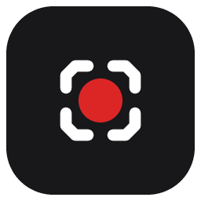

# Clarity

<p align="center">
  
</p>

<p align="center">
  <a href="https://github.com/jovanzhang6/clarity/actions/workflows/ci.yml"></a>
  
  
  
</p>

<p align="center">
  <b>极简录屏：开哪个声音录哪个，所见即所录。</b><br/>
  Windows 桌面应用 · Electron + 系统 ffmpeg · 无订阅、无水印、数据不出本机
</p>

<p align="center">
  简体中文 · <a href="./README.en-US.md">English</a>
</p>

<p align="center">
  
</p>

<p align="center">
  <a href="https://github.com/jovanzhang6/clarity/releases/latest"><strong>▶ 高清版演示视频（MP4）</strong></a>
</p>

---


## 为什么做Clarity

市面上的录屏工具要么重（OBS 的学习曲线）、要么贵（Screen Studio 订阅制）、要么把最关键的开关藏起来（录了半小时才发现没录上声音）。Clarity只做一件事：**把"录清楚"做到零心智负担**——

- 声音两路独立开关，**各带实时音量表**，录音前就能确认"真的录上了"；
- 画面**实时预览**，所见即所录；
- 保存分辨率和位置**录前就配好**，录完只差一个文件名。

## ✨ 特性

| | |
|---|---|
| 🖥 **画面/窗口选择** | 缩略图选择器，自动排除自身窗口；预览**实时**，点击可放大查看 |
| 🔊 **双声音通道** | 系统声音（电脑播的）与麦克风（你说的）独立开关，12 段实时音量表，任意组合 |
| 🖥 **录制中不挡路** | 可最小化到任务栏，可收起为置顶迷你悬浮条，录制视图自带实时监视器 |
| 🎚 **保存可控** | 原始/1080p/720p 三档，保存位置自选（默认 `D:\Recordings`），ffmpeg 转码 MP4 带进度 |
| ⏱ **细节** | 3 秒倒计时（可关）、暂停/继续、防休眠、中途关窗自动询问保存 |
| 🈶 **中文优先** | 为中文用户设计，零配置开箱即用 |


## 📦 安装

**方式一：下载安装包（推荐）**

到 [Releases](https://github.com/jovanzhang6/clarity/releases) 下载 `Clarity-x.y.z-Setup.exe`，双击安装。

**方式二：从源码运行**

```bash
git clone https://github.com/jovanzhang6/clarity.git
cd clarity
npm install        # 国内网络已配置 electron 镜像（.npmrc）
npm start
```

系统要求：Windows 10 19041+ / Windows 11，本机需已安装 [ffmpeg](https://www.gyan.dev/ffmpeg/builds/)（转码用）。

## 🚀 30 秒上手

1. **选画面** —— 主屏或某个窗口，预览实时可见；
2. **开声音** —— 系统声音、麦克风按需打开，音量条动了才是真的录上了；
3. **点开始** —— 3 秒倒计时后开录，录完点"停止并保存"，起个文件名落盘 MP4。

> 💡 会议/访谈场景建议：系统声音 + 麦克风全开（外放时建议戴耳机避免串音），分辨率 720p。


## 🧪 质量机制

Clarity不是 demo，测试分三层，全部可本地复现：

```bash
npm test         # ① 纯逻辑单元测试：采集参数、字节一致性、清理回收、配置持久化
npm run selftest # ② 端到端自检：真实录屏 5 秒 → 落盘校验 → 转码 → ffprobe/抽帧验证
node tools/check-layout.mjs  # ③ UI 布局断言（配合 --remote-debugging-port=9222 启动）
```

几个值得知道的设计决策：

- **分片写入串行成链**：MediaRecorder 的数据块顺序落盘，停止后等链排干再关文件，`finish()` 强校验"收到字节 == 磁盘字节"——宁可报错不丢帧；
- **绝不发裸系统音频请求**：Electron 已知问题（[#46369](https://github.com/electron/electron/issues/46369)），系统回环必须伴随有效桌面视频轨，且每次采集前重新校验源 ID，过期 ID 会让渲染进程被 Chromium 直接杀死；
- **系统声音走 loopback 通道**：Electron `setDisplayMediaRequestHandler` 的 `audio: "loopback"` 优先，gUM 回环仅在部分机器出声（实测对照数据见 git 历史）；音量表用 dBFS 对数刻度（-50dB 底），小声音不顶满；
- **不用原生 confirm/alert**：它们会在 Windows 上无焦点阻塞渲染进程，全部替换为应用内对话框。

更多排障工具在 [`tools/`](./tools)，端到端自检页面见 `npm run selftest`。

## 🏗 打包

```bash
npm run dist      # 产出 dist/Clarity-x.y.z-Setup.exe（NSIS 安装包）
```

## 🗺 Roadmap

- [ ] 区域录制（当前支持整屏/整窗口，裁剪在保存前逐片段进行）
- [ ] 系统音量静音检测提示（静音时系统声音会录成静音，当前靠音量表人工确认）
- [ ] 麦克风降噪开关
- [ ] 多语言
- [ ] 自动更新通道

欢迎提 issue 认领。

## 🤝 贡献

PR 欢迎。提交前请确保 `npm test` 全绿；涉及 UI 的改动请附截图。

## 📄 License

[MIT](./LICENSE) —— 免费商用，无水印，无上传。

## 致谢

- [Electron](https://www.electronjs.org/) / [ffmpeg](https://ffmpeg.org/)
- 灵感源自 [Screen Studio](https://screen.studio/) 与 [Cap](https://cap.so/)——Clarity想做他们覆盖不到的"轻量 + 可控"生态位
